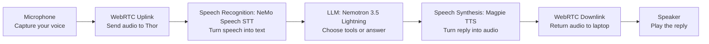
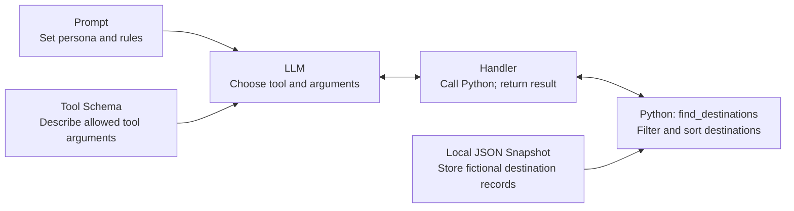

# Use the Car Destination-Finder Demo

Select `car_assistant` in the Generic Assistant to speak with Dash. Its `find_destinations` tool searches fictional charging, fuel, and parking destinations with fixed distances from **Demo Junction**.

This is a local snapshot, not your GPS location or a navigation service. Dash cannot control a vehicle, reserve parking, or check live traffic, opening hours, or charger availability. It reuses your existing speech recognition, large language model (LLM), and speech synthesis services without another server, model, or API key.

## Follow the Browser Audio Path

This diagram shows the local Thor browser path using WebRTC. The microphone and speaker are on your laptop; the models run on Thor. Speech-to-text (STT) recognizes speech, and text-to-speech (TTS) generates reply audio.



Pipecat coordinates the transport, models, conversation state, and tool execution as one voice-agent pipeline.

## Select Dash

Start the [Generic Assistant](../../src/examples/generic/README.md) with your existing deployment recipe. On Thor, keep `generic-assistant/single-gpu` and any existing Compose overrides.

Open `https://<host>:7860`. While disconnected, select `car_assistant` in **PROMPT**, reconnect, and allow microphone access. Expect Dash to ask whether you need charging, fuel, or parking. In **Tools**, confirm that `find_destinations` is enabled.

The original default and the legacy [Nova help-desk example](use-enterprise-helpdesk.md) remain available. Disconnect and reconnect when changing presets so the pipeline registers the selected tools.

## Search the Snapshot

Ask “Find charging stations.” Dash should call the tool and recommend Harbor Charge, the nearest match at 1.2 km from Demo Junction. Then say “Only within two kilometers.” The new search should keep the charging category and return Harbor Charge only.

The supplied fictional catalog contains:

| Category | Destination | Fixed Distance |
| --- | --- | --- |
| Charging | Harbor Charge | 1.2 km |
| Charging | Ridge Charge | 4.8 km |
| Fuel | Corner Fuel | 2.0 km |
| Parking | Market Parking | 0.7 km |
| Parking | Museum Parking | 3.5 km |

Results match the category and optional maximum distance, then sort by distance and name. The distance limit is inclusive. Try “Find charging within one kilometer”: no destination matches, so Dash should explain that result without inventing a closer station or widening the limit.

Start a new session to test a missing category. “Find somewhere nearby” should prompt for charging, fuel, or parking. Requests for navigation or live availability should receive the demo's limitation, not a claimed action.

The prompt requires lookup for new searches, changed requirements, and explicit refreshes. Unchanged follow-up details can use the latest actual tool result. Model adherence is not guaranteed: inspect the executed call and the spoken facts.

## Inspect the Function and Wiring

The prompt and tool schema configure the LLM. When it requests a lookup, the handler calls Python and returns the function's result:



The Python function reads the JSON snapshot. These are tool dependencies and request/result exchanges, separate from the audio stages above.

The tool runs in the existing Generic Assistant process. These files define it:

| File | Role |
| --- | --- |
| [prompts.yaml](../../src/examples/generic/prompts.yaml) | Dash persona and `tools_available: [find_destinations]` |
| [tools.yaml](../../src/examples/generic/tools.yaml) | Required category and optional `max_distance_km` schema |
| [tool_handlers.py](../../src/examples/generic/tool_handlers.py) | Registered handler and result callback |
| [destination_lookup.py](../../src/examples/generic/destination_lookup.py) | Argument validation, snapshot filtering, and sorting |
| [destination_fixtures.json](../../src/examples/generic/destination_fixtures.json) | Fictional fixed-origin data, licensed Apache 2.0 |

From the repository root, inspect the Python result without starting models:

```bash
PYTHONPATH=src python3 -c 'from examples.generic.destination_lookup import find_destinations; print(find_destinations("charging", 2))'
```

Expect `source: synthetic_training_data`, `snapshot_only: True`, origin Demo Junction, and Harbor Charge only. Categories are `charging`, `fuel`, and `parking`; category whitespace and case are normalized. An optional distance must be a positive finite number. Errors are `invalid_category`, `invalid_max_distance`, or `destination_catalog_unavailable`. An empty destinations list is a successful search with no matches.

After a spoken search, inspect logs using your deployment's existing Compose files. On Thor:

```bash
docker compose --profile generic-assistant/single-gpu logs --tail 100 generic-assistant-single-gpu
```

Find `Registered tool handler: find_destinations` and a new `find_destinations completed: ok` entry. The **Tools** card describes the offered schema; it does not prove execution. Compare the returned snapshot data with the reply.

## Use Another Client

For the [Realtime Gateway](use-realtime-gateway.md), select the preset in the initial session update. Temperature 0 reduces sampling randomness for reproducible checks:

```json
{"type":"session.update","session":{"type":"realtime","prompt":{"id":"car_assistant"},"temperature":0}}
```

The browser has no dedicated temperature control. API checks do not establish browser microphone recognition or live voice behavior.

With the [Reachy audio client](use-reachy-audio.md) prepared, run from the repository root:

```bash
uv run --no-project --with websockets==15.0.1 python scripts/reachy_audio_client.py --insecure --prompt-key car_assistant --allow-interruptions
```

`--insecure` accepts the local self-signed demonstration certificate; omit it for a trusted endpoint. The client selects Dash's catalog persona and tools instead of supplying its default Reachy instructions. This demo adds no vehicle or robot-control tool. Dash's live voice path still requires validation on your host.

Disconnect the browser or press **Ctrl+C** in the host client when finished. Select your previous preset to restore that session behavior; leave shared model services running for other work.
